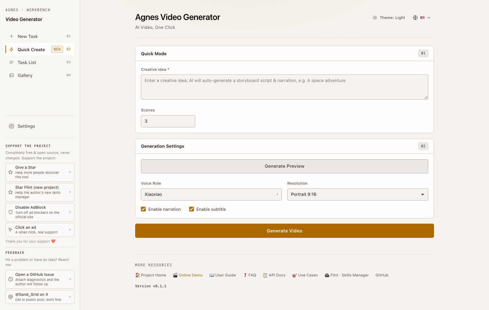

# 🎬 Agnes Video Generator — Completely Free AI Video Generator

[](README_ZH.md)
[](https://github.com/lcy362/agnes-video-generator)
[](https://github.com/lcy362/agnes-video-generator/blob/HEAD/LICENSE)
[](https://www.python.org/)
[](https://video.lichuanyang.top)
[](https://hub.docker.com/r/lcy362/free-short-video)
[](https://www.npmjs.com/package/free-short-video)
[](https://sonarcloud.io/project/overview?id=lcy362_agnes-video-generator)
[](https://sonarcloud.io/project/overview?id=lcy362_agnes-video-generator)

<p align="center">
  
</p>

<!--
schema.org structured data for SEO/GEO indexing. GitHub does not execute this script, but the raw JSON-LD is visible to search engines and AI engines that scan repository READMEs.
-->
<!--
<script type="application/ld+json">
{
  "@context": "https://schema.org",
  "@type": "SoftwareApplication",
  "name": "Agnes Video Generator",
  "alternateName": ["Free AI Video Generator", "Free Short Video"],
  "applicationCategory": "MultimediaApplication",
  "operatingSystem": "Linux, macOS, Windows",
  "description": "A completely free, open-source AI video generator (MIT) with two independent, production-ready editions: the Web Version (no install, one click) and the Downloadable Version (more features, one-command install). An agnes-video agent skill is also available for fully automated runs. Generate 4-12s 720P clips from text or images with Agnes Video 2.5 Flash, or build narrated, auto-subtitled multi-shot stories. No subscription, no credits, no watermark, no GPU: only a free Agnes AI API key is needed.",
  "url": "https://github.com/lcy362/agnes-video-generator",
  "downloadUrl": "https://github.com/lcy362/agnes-video-generator",
  "softwareVersion": "8.2.1",
  "dateModified": "2026-11-23",
  "releaseNotes": "https://github.com/lcy362/agnes-video-generator/blob/master/docs/public/release-notes/release_notes_v8.2.1.md",
  "license": "https://opensource.org/licenses/MIT",
  "isAccessibleForFree": true,
  "screenshot": "https://raw.githubusercontent.com/lcy362/agnes-video-generator/master/images/home.png",
  "softwareRequirements": "Python 3.10+; ffmpeg is bundled in the Docker and npm installs",
  "keywords": "free AI video generator, free AI video, free short video generator, AI video generator, text to video AI, image to video AI, Agnes Video, Agnes Video 2.5 Flash, AI video without watermark, no subscription AI video tool, open source AI video generator, self-hosted AI video, one-command install, zero-install browser workspace, agent skill, Runway alternative, Pika alternative",
  "featureList": [
    "Free text-to-video and image-to-video with Agnes Video 2.5 Flash (4-12s, 720P)",
    "Six task types: Single-shot clip, Multi-shot story, Manuscript video, Digital anchor, Poetry video, Simple image",
    "Multi-shot stories with AI screenwriting, free TTS narration and word-level subtitles",
    "Up to 8 reference images, first/last frames and reference audio",
    "Manual mode checkpoints, checkpoint resume and experimental external asset import",
    "Long task mode, fast retry with auto chaining and fatal-error classification",
    "22-language Web UI, MIT licensed; two independent editions: Web Version and Downloadable Version"
  ],
  "offers": {
    "@type": "Offer",
    "price": "0",
    "priceCurrency": "USD"
  },
  "author": {
    "@type": "Person",
    "@id": "https://lichuanyang.top/#author",
    "name": "SandGrid",
    "alternateName": "lcy362",
    "url": "https://lichuanyang.top/",
    "sameAs": [
      "https://github.com/lcy362",
      "https://gitee.com/sandgrid/agnes-video-generator",
      "https://video.lichuanyang.top/",
      "https://www.npmjs.com/package/free-short-video",
      "https://hub.docker.com/r/lcy362/free-short-video"
    ]
  }
}
</script>
-->

> **🌏 Mirror Notice / 镜像说明**
> This project is also mirrored on [Gitee](https://gitee.com/sandgrid/agnes-video-generator) for faster access in mainland China. The **GitHub repository is the primary home** of this project — issues, PRs, and stars are managed there.
> 本项目在国内 Gitee 设有镜像仓库，便于国内访问加速；**GitHub 为项目主仓库**，Issue / PR / Star 均在 GitHub 提交。

> **Completely free AI video generator** — Built on Agnes AI's free models: no subscription, no credits, no watermark, no high-end GPU. Generate a **free 4–12 s, 720P AI short video** from text or images with `agnes-video-2.5-flash`, or turn one idea into a **narrated, auto-subtitled multi-shot story** (1–30 shots). Six task types, checkpoint resume, manual mode, multi reference images and long task mode for busy queues. All AI compute runs in the cloud — a regular laptop is all you need. **Two independent, production-ready editions: the Web Version (no install, one click) and the Downloadable Version (more features); an agent skill is also available.** **[Try it online →](https://video.lichuanyang.top)**

> "The solution is not to suppress AI, but to make it a more equitable capability, so that everyone knows how to create more with AI. This is a very important vision for our company — to make world-class AI belong to everyone. What we can do may be insignificant, but this vision is very long-term and enduring."
>
> — Bruce Yang, Founder of Agnes AI

**[🌐 Official Website](https://video.lichuanyang.top)** | **[📝 Blog (中文)](https://lichuanyang.top/posts/22470/)** | **[📝 Blog (English)](https://lichuanyang.top/en/posts/22470/)**

> **🖥️ Use it in your browser — no install needed:** Visit [video.lichuanyang.top](https://video.lichuanyang.top) and use the live three-tab online creator directly in your browser. Enter a prompt and generate a free AI video instantly. This is the finished product, not a demo or beta.

## 🚀 Two Independent Editions — Plus an Agent Skill

> The website presents **two independent editions**: the **Web Version** (no install, one click) and the **Downloadable Version** (more features, one-command install). Both are finished, free products, not a "demo → full version" ladder. The `agnes-video` agent skill below is a supplementary channel — handy when you want an AI agent to run the entire pipeline — but it is not a third button on the site. All options share the same free Agnes AI models and MIT codebase.

| Way | What it is | What you actually need to do | Link |
|-----|------------|------------------------------|------|
| **① Downloadable Version** (self-hosted full app, this project) | The complete open-source app on your own machine: TTS narration, auto subtitles, digital anchor, image-to-video, keyframes, manuscript-to-video, checkpoint resume, 22-language Web UI | **Self-hosted, but simple to install** — one command (`npx free-short-video`, Docker or `start.sh`), then a Web UI takes over. **No technical background, no command-line experience, no "strong DIY skills" required.** | [GitHub](https://github.com/lcy362/agnes-video-generator) · [Getting Started](https://video.lichuanyang.top/en/guides/getting-started) |
| **② Web Version** (Online Creator / FreeShortVideo Studio) | The live three-tab online creator — image, single-shot clip and multi-shot story — generates and exports an MP4 in a browser tab | **No install, no signup, no setup, no server of your own**: open the page and generate. Production-ready and publicly usable, not a beta or a work in progress | [video.lichuanyang.top/demo](https://video.lichuanyang.top/en/demo) · [/studio](https://video.lichuanyang.top/en/studio) |
| **③ `agnes-video` agent skill** (supplementary channel) | An AI agent runs the **entire pipeline**: installs the service, generates the video, delivers the file, diagnoses failures and can open a PR for a real defect | Install one skill with one command, then just describe the outcome — no commands or flags to remember | [Skill repository](https://github.com/lcy362/agnes-video-generator-skills) · [Flint](https://github.com/lcy362/flint) |

**In one sentence:** two independent editions — start in one click with the Web Version (zero install), or install the Downloadable Version with one command for more features; neither requires technical skills. An agent skill can also run the whole pipeline for you.

## 🆕 Latest release — v8.2.1 (2026-11-23) / v8.2.0 (2026-11-19)

> **Featured update: common failure cases fully optimised — a much higher video generation success rate.** Same wording as the [featured update on the website](https://video.lichuanyang.top/en/releases).

This round targets the failure cases people hit most often: a saturated free queue, a mismatched key, interrupted runs and polling timeouts now each have an automatic path and a clear manual exit. At the centre is **Fast retry mode** in the browser workspace — instead of clicking retry and hoping, it claims a slot as soon as the free queue frees one up.

- **503 / `video_queue_full` has a built-in fix:** Fast retry mode opens after two consecutive busy signals and probes 30 times per minute for 3 minutes by default, with both values adjustable. An upstream 503 creates no task, consumes no quota and triggers no per-key rate limit, so probing faster is free and safe.
- **Chained, not a lucky click:** when a round ends, the next one starts automatically after the gap (5 min by default) with the same parameters. **Long task mode** runs retries within a total wait budget (60 min by default) with no attempt cap, until success or a manual stop; the progress panel shows attempts sent, time left and budget used.
- **Other common failures have clear exits too:** 401 distinguishes a key that does not match the domain instead of a generic error; interrupted runs resume from the last checkpoint without resubmitting finished scenes or reference images; the failure panel copies diagnostic info in one click and opens a pre-filled GitHub Issue.
- **Try it now in the Web Version** — no install, no GPU and no credit card; your free Agnes AI API key stays in browser localStorage. The **Downloadable Version** ships the same reliability fixes, plus HarfBuzz khatt shaping for Arabic subtitles (joined letters, right-to-left, tashkeel preserved), tall subtitles kept inside the frame and corrected API docs. No API changes.

Full list: **[v8.2.1 release notes](docs/public/release-notes/release_notes_v8.2.1.md)** · [v8.2.0 release notes](docs/public/release-notes/release_notes_v8.2.0.md) · [all release notes](docs/public/release-notes/).

## 🤖 Or Let an AI Agent Drive It

Install **one skill**, then describe the result you want. The `agnes-video` skill installs the
service, makes the video, delivers the file and diagnoses failures — **you never clone this
repository**, and the skill is useful on its own, not just as an add-on to this project. It is also
**the cheapest way to start**: no subscription, no credit packs, no per-second billing, no GPU — just
one free API key.

```bash
git clone https://github.com/lcy362/agnes-video-generator-skills.git
npx flint-skills-hub     # Sources → add the cloned directory (flint reads its skills/ subdirectory)
```

[**flint**](https://github.com/lcy362/flint) is a local-first, open-source skills manager: it deploys
the skill into any agent directory (Claude Code, Cursor, Codex, TRAE and more) by symlink or copy,
with no cloud, no account and no telemetry. It works on local sources only — it never clones anything
for you — so you register the directory you just cloned.

**Or copy it in by hand** — no flint required, but you repeat it for every project and every new agent:

```bash
cp -R agnes-video-generator-skills/skills/agnes-video <project>/.agents/skills/   # any agent that reads .agents/skills
```

**The skill installs the service too.** It runs `scripts/bootstrap.py install`, which puts the
service under `~/.agnes-video` (override with `AGNES_HOME`), keeps its own virtualenv there, starts it
on `localhost:8765`, and re-runs nothing on the next use. Config, workspace, outputs and logs live in
that same data root.

**Then ask for outcomes** — no commands, no flags:

> "Make a creative long video about the Voyager probes, with narration and subtitles."

> "My task `4de1bcd26fda` failed — find out why and tell me if it is worth fixing."

> "Take my finished task, improve the storyboard prompts, and regenerate only the affected scenes."

One loop, five stages — and it stays in the same skill, so nothing is lost between them:

| Stage | What it does |
|-------|--------------|
| Install | Bootstrap the service under `~/.agnes-video` and verify it through the real endpoints |
| Create | Pick the pipeline, take the key safely, submit the task, report progress |
| Deliver | Copy the file to `$AGNES_HOME/outputs/<task_id>/` and report path, duration, resolution |
| Diagnose | Classify a failure as configuration, upstream capacity, or a genuine defect |
| Fix | After you agree: fork, fix a small defect, run pre-flight, open a PR |

Full guide: **[Let an AI Agent Operate This Project](docs/public/agent-operations.md)**.

## ⭐ Support & Contribute

If you find this project useful, please **star the [GitHub repository](https://github.com/lcy362/agnes-video-generator)** ⭐ — your support helps more people discover this free and open-source AI video generator.

Bug reports and feature suggestions are welcome via [GitHub Issues](https://github.com/lcy362/agnes-video-generator/issues).

### 💝 Support the Developer

Agnes Video Generator is and will always remain completely free and open-source. There will be **no paid plans, no premium features, and no subscription services** — now or in the future.

If you find this project helpful, here are a few ways to support its continued development:

- **⭐ Star on GitHub** — Star the [repository](https://github.com/lcy362/agnes-video-generator) to help others discover this project.
- **🪨 Star the author's new project [Flint](https://github.com/lcy362/flint)** — a local-first AI skills manager for your Claude Code / Cursor / other agents. Centralize, tag and reuse the skills you keep building.
- **🌐 Whitelist the official website** — Turn off your ad blocker on [video.lichuanyang.top](https://video.lichuanyang.top) and click on an ad if something catches your eye. A small gesture that makes a real difference.
- **📢 Share your creations** — Post videos made with Agnes Video Generator on social media (Douyin, YouTube, Xiaohongshu, etc.) and tag the project. More exposure means more users, more feedback, and a better tool for everyone.

## 🎥 Demo

Three clips from the most recent batch on the [official showcase](https://video.lichuanyang.top/en/showcase). Each one was generated from a single prompt in simple video mode — no editing, no compositing.

### 1. Cold Corridor — Dolly Back From an Extreme Closeup

> Opens on an extreme facial close-up, then a real dolly-back to a head-and-shoulders frame in a cool grey corridor — pores, flyaway hair and the cobalt turtleneck all hold. 12s, landscape, 720P.

[](https://video.lichuanyang.top/en/showcase/ab-01-cold-corridor-face-closeup)

### 2. Tang Dynasty Night Sakura — Portrait

> A Tang-dynasty high bun and hairpins under night cherry blossoms: petals drift past, lantern glow lands on the cheek, the camera slides slowly sideways. 6s, portrait, 720P.

[](https://video.lichuanyang.top/en/showcase/ab-03-tang-dynasty-night-sakura)

### 3. Red Studio — Perfume Commercial

> A perfume spot in a red studio: the mist sprays, a profile and red lips in close-up, a slow push-in and clean commercial lighting. 10s, landscape, 720P.

[](https://video.lichuanyang.top/en/showcase/ab-12-red-studio-perfume-ad)

<sub>Browse the full gallery: [video.lichuanyang.top/showcase](https://video.lichuanyang.top/en/showcase)</sub>

## Why Agnes Video Generator?

Making AI videos today has an absurdly high barrier. Overseas services like Runway and Pika charge monthly subscriptions of tens of dollars. Domestic platforms like Jimeng and Keling charge by the second once their free quotas run out. Want to run open-source models locally? A GPU capable of video generation easily costs over ten thousand RMB. For most people who want to try AI video creation, the door is essentially closed.

We believe what Bruce Yang said — AI should be a more equitable capability. World-class AI should belong to everyone, not just those who can afford the bill.

To be honest, Agnes's video model isn't perfect yet. The generated frames are sometimes unstable, complex actions occasionally deform, and the free shared queue can be busy. But it is **completely free with no per-user quota** (v8.2.0 adds long task mode and auto-chained fast retry for busy queues), and it iterates fast. We choose to grow with it rather than wait for a "perfect" commercial solution. If you share this mindset, then this project is for you — all you need is a free [Agnes AI](https://platform.agnes-ai.com) API key and either of the two editions above — the Web Version in a browser tab (nothing to install) or the Downloadable Version on an ordinary computer (one command). Neither requires a powerful machine or strong technical skills; an agent skill is also available to run the whole pipeline.

### Comparison: free AI video generator vs. commercial AI video tools

Vendor plans change frequently — check each vendor's current pricing. This project has no paid tier.

| Feature | Agnes Video Generator (this repo) | Typical paid tools (Runway / Pika / Sora / Kling …) |
|---------|:---:|:---:|
| **Price** | Free, MIT, no paid tier in this project | Subscription or credit / per-second billing |
| **Open source / self-hosted** | ✅ Yes | ❌ Usually no |
| **Free clip length** | 4–12 s at 720P (`agnes-video-2.5-flash`); 1–30 shots stitched into multi-shot stories | Usually 5–20 s per clip; varies by plan |
| **Aspect ratios** | 21:9 / 16:9 / 4:3 / 1:1 / 3:4 / 9:16 | Varies by vendor |
| **Text-to-video / image-to-video / first+last frame** | ✅ Built in | Varies by vendor |
| **Multi-scene pipeline, free TTS narration, word-level subtitles** | ✅ Built in | Usually manual editing or third-party tools |
| **Digital anchor / poetry / manuscript modes** | ✅ Built in | Rare |
| **Watermark** | No watermark added by this app | Varies; free tiers often add one |
| **GPU** | ❌ Not needed (cloud API) | ❌ Not needed (cloud API) |
| **Limits** | No per-user quota; local token bucket ≈16 req/min per key; the free shared queue can be busy, with auto-retry, fast retry and long task mode | Quota / credits per billing plan |

## ❓ Free AI Video Generator FAQ

**Is this AI video generator really free?** Yes. The app is MIT-licensed with no paid tier, no credits and no per-second billing. All model calls use Agnes AI's free models; you supply one free API key from [Agnes AI](https://platform.agnes-ai.com).

**Do I need to sign up or a credit card for a free AI video generator with no sign up?** There is no account, subscription or credit card for this project. You can start in the browser with zero install, let an AI agent run the whole pipeline, or self-host with one command — none of the three needs technical skills. You do need a free Agnes AI API key to call the upstream models; no key is stored on any server of this project.

**Can I generate a free AI video from text or from an image?** Yes. Single-shot clip supports text-to-video, image-to-video, first/last frames, up to 5 reference images on Flash (8 on 2.5) and reference audio. The one-click preset is `agnes-video-2.5-flash` / 5 s / 16:9 / 720P.

**Is the AI video without watermark?** Yes — this app adds no watermark, and the generated files stay on your machine. For commercial use, check the upstream model's terms.

**Can I make free AI short videos for YouTube Shorts, TikTok or Reels?** Yes. Pick a portrait aspect ratio for a single clip, or use Multi-shot story / Manuscript video to build a longer narrated story with subtitles. Note the known upstream 9:16 rotation defect on 2.5-series models; 16:9 and 3:4 are safe.

**What is the difference between Agnes Video, Agnes AI and this GitHub repository?** [Agnes AI](https://platform.agnes-ai.com) provides the free models and API keys. **Agnes Video** usually refers to those video models (`agnes-video-2.5-flash`). This repository is the independent, MIT-licensed open-source app built on them; [`agnes-video-generator-skills`](https://github.com/lcy362/agnes-video-generator-skills) is its optional AI-agent skill. If you searched "agnes video generator github", you are in the right place — GitHub is the project's primary home.

**The free video queue is full — now what?** A saturated shared queue rejects submissions with HTTP 503 `video_queue_full`; nothing is consumed. Since v8.2.0 you can enable fast retry (with automatic chained rounds) or long task mode (a cumulative wait budget instead of a fixed retry count), while fatal errors fail fast with a clear reason.

More answers: [FAQ](docs/public/faq.md) · [Usage guide](docs/public/usage.md) · [GitHub Wiki](https://github.com/lcy362/agnes-video-generator/wiki).

## ⚙️ Configuration

Everything is configured through environment variables — no config file is required. To start from a documented template:

```bash
cp .env.example .env    # then edit AGNES_API_KEY inside
```

[`.env.example`](.env.example) lists every supported variable with its default value: API key, multi-key rotation, rate limits, port, model overrides, and maintenance options.

> **Have more than one API key?** Set `AGNES_API_KEY`, `AGNES_API_KEY_2`, `AGNES_API_KEY_3` … (numbering must be contiguous). Rate-limit quotas scale with your key count, a `429` automatically rotates to the next key, and the concurrency limit scales along with it.

> **Busy queue?** Long task mode and fast-retry defaults are configurable with `AGNES_LONG_TASK_ENABLED`, `AGNES_LONG_TASK_MINUTES`, `AGNES_FAST_RETRY_PER_MINUTE` and `AGNES_FAST_RETRY_MINUTES`, or per task from the progress page.

Full walkthrough: [Getting Started → Configure API Key](docs/public/getting-started.md).

## 📚 Documentation

- **[Features](docs/public/features.md)** — Six task types, the completely free Agnes model chain, AI narration & smart subtitles, reference images, long task mode and the 22-language Web UI.
- **[Getting Started](docs/public/getting-started.md)** — Install and deploy in 4 ways: Manual (`start.sh`), Docker, npm (`npx free-short-video`), or AI-Agent assisted.
- **[Usage Guide](docs/public/usage.md)** — Configure your API key, pick a task type, use long task mode / fast retry, resume from checkpoints, and find logs and outputs.
- **[Manual Mode Guide](docs/public/manual_mode_guide.md)** — Pause at checkpoints, edit artifacts, then continue.
- **[AI Agent Operations](docs/public/agent-operations.md)** — Drive this project with a coding agent: install the standalone `agnes-video` skill once, then ask for outcomes — it installs the service, generates videos, diagnoses failures and can open a PR for a real defect.
- **[Architecture](docs/public/architecture.md)** — Project structure and tech stack.
- **[API Reference](docs/public/api.md)** — Full REST endpoint list (progress via polling, no WebSocket).
- **[FAQ](docs/public/faq.md)** — Frequently asked questions about free AI video generation.
- **[About & License](docs/public/about.md)** — Acknowledgments and the MIT license.
- **[Release notes](docs/public/release-notes/)** — What changed in v8.2.0 and earlier releases.
- **[GitHub Wiki](https://github.com/lcy362/agnes-video-generator/wiki)** — 22-language guides, prompt examples and the learning center.

## 🌐 Related Projects

More projects by the same author:

- **[Agnes Video Generator](https://github.com/lcy362/agnes-video-generator)** — Completely free AI video generator (this project).
- **[FreeShortVideoStudio](https://github.com/lcy362/free-short-video-studio)** — Fully online, in-browser video studio.
- **[Flint](https://github.com/lcy362/flint)** — Local-first AI skills manager: centralize, tag, deduplicate and deploy your Skills into any agent or project directory. If it helps you, a star is very welcome! ⭐

**Keywords**: free AI video generator, free AI video, free short video generator, free AI video maker, free AI short video, AI video generator without watermark, text to video AI, image to video AI, Agnes Video, Agnes Video 2.5 Flash, Agnes Video Generator GitHub, open source AI video generator, self-hosted AI video, one-command install, no technical skills needed, zero-install browser workspace, agent skill, no subscription AI video tool, Runway alternative, Pika alternative, AI narration, auto subtitles
