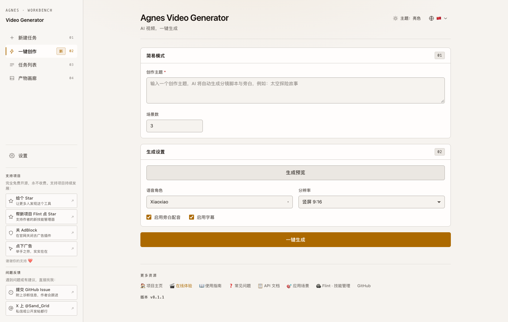

# 🎬 Agnes Video Generator — 完全免费的 AI 视频生成工具

[](README.md)
[](https://github.com/lcy362/agnes-video-generator)
[](https://github.com/lcy362/agnes-video-generator/blob/HEAD/LICENSE)
[](https://www.python.org/)
[](https://video.lichuanyang.top)
[](https://hub.docker.com/r/lcy362/free-short-video)
[](https://www.npmjs.com/package/free-short-video)
[](https://sonarcloud.io/project/overview?id=lcy362_agnes-video-generator)
[](https://sonarcloud.io/project/overview?id=lcy362_agnes-video-generator)

<p align="center">
  
</p>

<!--
schema.org 结构化数据，供搜索引擎与 AI 引擎索引。GitHub 不会执行该脚本，但源码中的 JSON-LD 可被爬取 README 的引擎读取。
-->
<!--
<script type="application/ld+json">
{
  "@context": "https://schema.org",
  "@type": "SoftwareApplication",
  "name": "Agnes Video Generator",
  "alternateName": ["免费 AI 视频生成器", "免费 AI 短视频工具"],
  "applicationCategory": "MultimediaApplication",
  "operatingSystem": "Linux, macOS, Windows",
  "description": "完全免费、开源（MIT）的 AI 视频生成工具。用 Agnes Video 2.5 Flash 从文字或图片生成 4–12 秒 720P 视频，也能把一句话创意变成带旁白与字幕的多场景故事。无订阅、无积分、无水印、无需显卡，自托管只需一个免费的 Agnes AI API Key。",
  "url": "https://github.com/lcy362/agnes-video-generator",
  "downloadUrl": "https://github.com/lcy362/agnes-video-generator",
  "softwareVersion": "8.2.0",
  "dateModified": "2026-11-23",
  "releaseNotes": "https://github.com/lcy362/agnes-video-generator/blob/master/docs/public/release-notes/release_notes_v8.2.0.md",
  "license": "https://opensource.org/licenses/MIT",
  "isAccessibleForFree": true,
  "screenshot": "https://raw.githubusercontent.com/lcy362/agnes-video-generator/master/images/home-zh.png",
  "softwareRequirements": "Python 3.10+；Docker 与 npm 安装已内置 ffmpeg",
  "keywords": "免费AI视频生成器, 免费AI视频生成工具, 免费AI短视频, AI视频生成软件, 文生视频, 图生视频, Agnes Video, Agnes Video 2.5 Flash, 无水印AI视频, 无需订阅的AI视频工具, 开源视频生成器, 自托管AI视频, Runway开源替代, Pika开源替代",
  "featureList": [
    "免费的文生视频与图生视频：Agnes Video 2.5 Flash（4–12 秒，720P）",
    "六种任务类型：单镜头短片、多镜头故事、稿件长视频、数字人口播、诗词视频、简单图片",
    "多镜头故事含 AI 编剧、免费 TTS 旁白与词级字幕",
    "最多 8 张参考图、首尾帧与参考音频",
    "手动模式检查点、断点续传与试验中的外部素材导入",
    "长任务模式、快速重试自动接力与不可重试错误分类",
    "22 语言界面、MIT 协议、自托管，只需免费 Agnes AI API Key"
  ],
  "offers": {
    "@type": "Offer",
    "price": "0",
    "priceCurrency": "USD"
  },
  "author": {
    "@type": "Person",
    "@id": "https://lichuanyang.top/#author",
    "name": "SandGrid",
    "alternateName": "lcy362",
    "url": "https://lichuanyang.top/",
    "sameAs": [
      "https://github.com/lcy362",
      "https://gitee.com/sandgrid/agnes-video-generator",
      "https://video.lichuanyang.top/",
      "https://www.npmjs.com/package/free-short-video",
      "https://hub.docker.com/r/lcy362/free-short-video"
    ]
  }
}
</script>
-->

> **🌏 镜像说明 / Mirror Notice**
> 本项目在国内 Gitee 设有镜像仓库（[gitee.com/sandgrid/agnes-video-generator](https://gitee.com/sandgrid/agnes-video-generator)），便于国内访问加速；**GitHub 为项目主仓库**，Issue / PR / Star 均在 GitHub 提交。
> This project is also mirrored on Gitee for faster access in mainland China; the GitHub repository is the primary home for issues, PRs and stars.

> **完全免费的 AI 视频生成器 / 免费 AI 短视频工具** — 基于 Agnes AI 免费模型：无订阅、无积分、无水印、无需高端显卡。用 `agnes-video-2.5-flash` 从文字或图片生成 **4–12 秒、720P 的免费 AI 短视频**，也能把一句话创意变成**带旁白配音与字幕的多镜头故事**（1–30 个镜头）。六种任务类型、断点续传、手动模式、多参考图与长任务模式，所有 AI 计算在云端完成，普通笔记本就能跑。**[在线体验 →](https://video.lichuanyang.top)**

> "解决的办法不是压制 AI，而是让它变成一种更平权的能力，让每个人都知道如何借 AI 创造更多。这也是我们公司很重要的愿景，让世界级的 AI 属于每一个人。我们能做的可能微不足道，但这个愿景非常长久、持久。"
>
> —— Bruce Yang，Agnes AI 创始人

**[🌐 官网](https://video.lichuanyang.top)** | **[📝 博客文章（中文）](https://lichuanyang.top/posts/22470/)** | **[📝 Blog (English)](https://lichuanyang.top/en/posts/22470/)**

> **🖥️ 在线体验 — 免安装：** 打开 [video.lichuanyang.top](https://video.lichuanyang.top) 即可在浏览器中使用 **单镜头短片**（原「简单视频」）模式。输入提示词，立刻生成免费的 AI 视频。

## 🚀 三种使用方式 — 均完全免费

| 项目 | 运行方式 | 功能定位 | 链接 |
|------|---------|---------|------|
| **[Agnes Video Generator](https://github.com/lcy362/agnes-video-generator)**（本项目） | **下载后本地运行** | **功能更强大** —— TTS 配音、自动字幕、数字人、图生视频、关键帧动画、文章成片、断点续传等 | [GitHub](https://github.com/lcy362/agnes-video-generator) |
| **[FreeShortVideoStudio](https://github.com/lcy362/free-short-video-studio)** | **完全在线，浏览器内运行** | 轻量免安装、零配置，**功能建设中** | [video.lichuanyang.top/studio](https://video.lichuanyang.top/studio) · [GitHub](https://github.com/lcy362/free-short-video-studio) |
| **[Agnes Video Generator](https://github.com/lcy362/agnes-video-generator)** —— **支持 AI Agent 驱动** | **交给 AI 编程 Agent 运行** | **最省事，而且一样完全免费** —— 装一个独立的 `agnes-video` skill：它自己装服务、出片、交付成片，失败时排查原因，还能为真正的缺陷提 PR。无积分、无订阅、不需要显卡 | [技能库仓库](https://github.com/lcy362/agnes-video-generator-skills) · [Flint](https://github.com/lcy362/flint) |

## 🆕 最新版本 — v8.2.0（2026-11-19）

- **六种任务类型**，22 种界面语言同步改名：**单镜头短片**（一条 4–12 秒视频，成功率高）与**多镜头故事**（1–30 个镜头拼接成故事），另有稿件长视频、数字人口播、诗词视频、简单图片。
- **当前免费模型链**：`agnes-3.0-flash`（文本）→ `agnes-image-2.5-flash`（图片）→ `agnes-video-2.5-flash`（视频，4–12 秒、720P）→ Edge TTS（旁白）。旧的 `agnes-video-v2.0` 通道已下线。
- **长任务模式**：免费上游队列繁忙时，可按累计等待时长（默认 60 分钟，5–480 可调）继续重试，而不是固定次数用完就停；**快速重试**支持自动接力下一轮；无效 Key、参数被拒、内容审核等确定性错误会立即失败并给出具体原因。
- **多参考图**（v8.1）：Flash 最多 5 张 / 2.5 最多 8 张，另支持首尾帧与参考音频；**手动模式**可在检查点暂停并编辑产物；**外部素材模式**（即梦，试验中）可导入外部生成的片段。
- 依旧免费且自托管：断点续传、词级字幕、22 语言界面，以及独立的 [`agnes-video` Agent 技能](https://github.com/lcy362/agnes-video-generator-skills)。

完整清单：**[v8.2.0 发版说明](docs/public/release-notes/release_notes_v8.2.0.md)** · [全部发版说明](docs/public/release-notes/)。

## 🤖 或者，让 AI Agent 来操作

装上**一个 skill**，之后只描述想要的结果。`agnes-video` 会自己装服务、出片、交付文件并排查失败——**你不必 clone 本仓库**，这个 skill 也是独立的，不只是本项目的附属。它同样是**最省钱的起点**：无订阅、无积分包、无按秒计费、不用显卡，只需要一个免费 API key。

```bash
git clone https://github.com/lcy362/agnes-video-generator-skills.git
npx flint-skills-hub     # Sources → 添加刚 clone 的目录（flint 会读它的 skills/ 子目录）
```

[**flint**](https://github.com/lcy362/flint) 是一个本地优先的开源技能管理器：通过 symlink 或复制把这个 skill 投放到任意 Agent 目录（Claude Code、Cursor、Codex、TRAE 等），无云端、无账号、无上报。它只认本地源、**不会替你联网拉取**，所以你要登记的就是刚 clone 下来的这个目录。

**或者手动拷贝**——不用 flint 也行，代价是每个项目、每上一个新 Agent 都要再来一次：

```bash
cp -R agnes-video-generator-skills/skills/agnes-video <项目>/.agents/skills/   # 任何读 .agents/skills 的 Agent 都能用
```

**服务也由 skill 装。** 它会跑 `scripts/bootstrap.py install`，把服务装进 `~/.agnes-video`（可用 `AGNES_HOME` 覆盖），在同一处维护自己的 virtualenv，在 `localhost:8765` 启动，并且第二次使用不重复安装。配置、工作区、成片与日志都在这同一个数据根目录里。

**然后，交代结果** —— 不用命令、不用参数：

> "做一条关于旅行者号的创意长视频，要旁白和字幕。"

> "我的任务 `4de1bcd26fda` 失败了——查清原因，并告诉我值不值得修。"

> "拿我那个已完成的任务，把分镜提示词优化一下，然后只重跑受影响的部分。"

一条闭环、五个阶段，而且始终在同一个 skill 里，前后不丢上下文：

| 阶段 | 具体做什么 |
|------|------------|
| 安装 | 把服务装进 `~/.agnes-video`，并通过真实端点验证可用 |
| 创作 | 选流水线，安全接收 Key，提交任务，汇报进度 |
| 交付 | 把文件复制到 `$AGNES_HOME/outputs/<task_id>/`，报告路径、时长与分辨率 |
| 排查 | 把失败归类为配置问题、上游容量问题或真正的缺陷 |
| 修复 | 在你同意后：fork、修一个小缺陷、跑自检、提交 PR |

完整说明：**[让 AI Agent 来操作本项目](docs/public/agent-operations.zh.md)**。

## ⭐ 支持与贡献

如果你觉得这个项目有用，请给 **[GitHub 仓库](https://github.com/lcy362/agnes-video-generator)点个 Star** ⭐ —— 你的支持能让更多人发现这个免费开源的 AI 视频生成工具。

欢迎通过 [GitHub Issues](https://github.com/lcy362/agnes-video-generator/issues) 提交问题反馈或功能建议。

### 💝 支持开发者

Agnes Video Generator 完全免费且开源，**本项目绝不会提供付费计划、增值服务或订阅模式**——无论现在还是将来。

如果你觉得这个项目对你有帮助，可以通过以下方式支持它持续发展：

- **⭐ 在 GitHub 上点 Star** — 给[仓库](https://github.com/lcy362/agnes-video-generator)点个 Star，帮助更多人发现这个项目。
- **🪨 帮作者的新项目 [Flint](https://github.com/lcy362/flint) 点个 Star** —— 一个本地优先的 AI Skills（技能）管理器，配合 Claude Code / Cursor 等 Agent 使用，帮助你把经常用到的技能集中归档、打标并复用。
- **🌐 在官网关闭去广告插件** — 在 [video.lichuanyang.top](https://video.lichuanyang.top) 上关闭 AdBlock 等去广告工具，看到感兴趣的广告可以点一下。举手之劳，却是实实在在的支持。
- **📢 分享你的创作** — 将你用 Agnes Video Generator 生成的视频发布到社交媒体（抖音、YouTube、小红书等）并标注本项目。让更多人知道这个工具，更多的用户意味着更多的反馈，项目也会变得更好。

## 🎥 Demo

以下 3 条来自[官网作品库](https://video.lichuanyang.top/zh/showcase)最新一批（2026-11-09 发布），都是在简单视频模式下一句提示词直出，没有剪辑与合成。

### 1. 冷调走廊｜极近怼脸后拉

> 起幅是极近怼脸，镜头实拍后拉到半身，冷灰走廊配钴蓝高领毛衣，毛孔与碎发细节都保留。12 秒横版，720P。

[](https://video.lichuanyang.top/zh/showcase/ab-01-cold-corridor-face-closeup)

### 2. 盛唐夜樱｜古装高髻人像

> 盛唐高髻与发簪立于夜樱之下，花瓣掠过、灯笼暖光落在脸颊，镜头缓慢横移。6 秒竖版，720P。

[](https://video.lichuanyang.top/zh/showcase/ab-03-tang-dynasty-night-sakura)

### 3. 红色片场｜香水广告

> 红色片场里的香水广告：喷雾炸开，侧脸与红唇近景，缓慢推进，灯光干净利落。10 秒横版，720P。

[](https://video.lichuanyang.top/zh/showcase/ab-12-red-studio-perfume-ad)

<sub>更多作品：[video.lichuanyang.top/showcase](https://video.lichuanyang.top/zh/showcase)</sub>

## 为什么选择 Agnes Video Generator？

现在做 AI 视频，门槛高得离谱。国外的 Runway、Pika 按月订阅动辄几十美元，国内的即梦、可灵免费额度一用完就按秒计费。想自己在本地跑开源模型？一张能跑视频生成的显卡轻松上万。对于大多数想尝试 AI 视频创作的人来说，这道门基本上是关着的。

我们相信 Bruce Yang 说的那句话——AI 应该是一种更平权的能力。世界级的 AI 应该属于每一个人，而不是只属于付得起账单的人。

坦白讲，Agnes 的视频模型现在还不够完美：生成的画面有时不够稳定，复杂动作偶尔会变形，免费共享队列也可能繁忙。但它**完全免费、没有按用户配额**（v8.2.0 起可用长任务模式与自动接力的快速重试应对排队），而且迭代速度很快。我们选择跟它一起成长，而不是等着一个「完美」的商业方案出现。如果你也认同这个想法，那么这个项目就是为你准备的——你只需要一个免费的 [Agnes AI](https://platform.agnes-ai.com) API Key 和一台能跑 Python 的普通电脑，就可以零成本开始 AI 视频创作。

### 对比：免费 AI 视频生成器与商业 AI 视频工具

各家套餐经常调整，具体价格以厂商当前页面为准；本项目没有付费档。

| 特性 | Agnes Video Generator（本仓库） | 常见付费工具（Runway / Pika / Sora / 可灵 …） |
|------|:---:|:---:|
| **价格** | 完全免费、MIT、无付费档 | 订阅制或积分 / 按秒计费 |
| **开源 / 自托管** | ✅ 支持 | ❌ 通常不支持 |
| **免费单段时长** | 4–12 秒、720P（`agnes-video-2.5-flash`）；多镜头故事可拼接 1–30 个镜头 | 通常单段 5–20 秒，随套餐变化 |
| **画幅比例** | 21:9 / 16:9 / 4:3 / 1:1 / 3:4 / 9:16 | 各厂商不同 |
| **文生视频 / 图生视频 / 首尾帧** | ✅ 内置 | 各厂商不同 |
| **多场景流水线、免费 TTS 旁白、词级字幕** | ✅ 内置 | 多需手动剪辑或第三方工具 |
| **数字人口播 / 诗词 / 稿件成片** | ✅ 内置 | 少见 |
| **水印** | 本应用不添加水印 | 各厂商不同，免费档常有水印 |
| **GPU** | ❌ 不需要（云端 API） | ❌ 不需要（云端 API） |
| **使用限制** | 无按用户配额；本地令牌桶约 16 次/分钟/Key；免费共享队列可能繁忙，可自动重试、快速重试或开长任务模式 | 按套餐配额 / 积分 |

## ❓ 免费 AI 视频生成器常见问题

**免费 AI 视频生成器真的免费吗？** 是的。本项目 MIT 开源，没有付费档、积分包或按秒计费。所有模型调用走 Agnes AI 的免费模型，你只需在 [Agnes AI](https://platform.agnes-ai.com) 申请一个免费 API Key。

**「免注册、无限制」是真的吗？需要信用卡吗？** 本项目本身无需注册账号、无需订阅、无需信用卡，装在自己机器上即可。调用上游模型需要一个免费的 Agnes AI API Key；项目侧不保存你的 Key，也不设按用户配额。

**免费 AI 视频生成工具支持文生视频、图生视频吗？** 支持。单镜头短片可用文字、图片、首尾帧，Flash 最多 5 张参考图（2.5 最多 8 张）以及参考音频；一键预设为 `agnes-video-2.5-flash` / 5 秒 / 16:9 / 720P。

**生成的 AI 视频有水印吗？** 本应用不添加水印，成片保存在本机。商用前请自行确认上游模型的使用条款。

**能做 YouTube Shorts / 抖音 / TikTok 的免费 AI 短视频吗？** 可以。单段选竖版画幅，或用多镜头故事 / 稿件长视频生成带旁白字幕的较长视频。注意 2.5 系列 9:16 存在上游画面躺倒缺陷，16:9 与 3:4 更安全。

**Agnes Video、Agnes AI 和这个 GitHub 仓库是什么关系？** [Agnes AI](https://platform.agnes-ai.com) 提供免费模型和 API Key；**Agnes Video** 通常指 `agnes-video-2.5-flash` 等视频模型；本仓库是基于这些模型的独立 MIT 开源应用，[`agnes-video-generator-skills`](https://github.com/lcy362/agnes-video-generator-skills) 是可选的 AI Agent 技能。搜「agnes video generator github」找到的正是项目主仓库。

**免费视频队列满了怎么办？** 共享队列饱和时会返回 HTTP 503 `video_queue_full`，不会消耗任何配额。v8.2.0 起可开启快速重试（自动接力下一轮）或长任务模式（按累计等待时长而非固定次数），确定性错误则立即失败并给出具体原因。

更多解答：[常见问题](docs/public/faq.zh.md) · [使用说明](docs/public/usage.zh.md) · [GitHub Wiki](https://github.com/lcy362/agnes-video-generator/wiki)。

## ⚙️ 配置说明

所有配置均通过环境变量设置，无需配置文件。如需一份带注释的模板，可直接复制项目自带的 `.env.example`：

```bash
cp .env.example .env    # 然后编辑其中的 AGNES_API_KEY
```

[`.env.example`](.env.example) 列出了全部支持的环境变量及其默认值：API Key、多 Key 轮询、限速参数、服务端口、模型覆盖与运维选项。

> **有多个 API Key？** 依次设置 `AGNES_API_KEY`、`AGNES_API_KEY_2`、`AGNES_API_KEY_3` …（序号必须连续）。限速配额会随 Key 数量线性放大，遇到 429 会自动轮换到下一个 Key，并发上限也随之提升。

> **队列繁忙？** 长任务模式与快速重试的默认值可用 `AGNES_LONG_TASK_ENABLED`、`AGNES_LONG_TASK_MINUTES`、`AGNES_FAST_RETRY_PER_MINUTE`、`AGNES_FAST_RETRY_MINUTES` 配置，也可在进度页按任务开启。

完整步骤见：[快速开始 → 配置 API Key](docs/public/getting-started.zh.md)。

## 📚 文档导航

- **[核心功能](docs/public/features.zh.md)** — 六种任务类型、完全免费的 Agnes 模型链、AI 旁白配音与智能字幕、多参考图、长任务模式与 22 语言 Web UI。
- **[快速开始](docs/public/getting-started.zh.md)** — 4 种部署方式：手动（`start.sh`）、Docker、npm（`npx free-short-video`）、AI Agent 辅助。
- **[使用说明](docs/public/usage.zh.md)** — 配置 API Key、选择任务类型、长任务模式 / 快速重试、断点续传，以及日志与输出目录。
- **[手动模式指南](docs/public/manual_mode_guide.md)** — 在检查点暂停、编辑产物后继续生成。
- **[AI Agent 操作指南](docs/public/agent-operations.zh.md)** — 用编程 Agent 驱动本项目：装一次独立的 `agnes-video` skill，之后交代结果即可——它自己装服务、出片、排查失败，还能为真正的缺陷提 PR。
- **[项目架构](docs/public/architecture.zh.md)** — 项目结构与技术栈。
- **[API 接口](docs/public/api.zh.md)** — 完整 REST 接口列表（进度经任务状态轮询获取，无 WebSocket）。
- **[常见问题](docs/public/faq.zh.md)** — 免费 AI 视频生成的高频疑问解答。
- **[关于与许可](docs/public/about.zh.md)** — 致谢与 MIT 开源协议。
- **[发版说明](docs/public/release-notes/)** — v8.2.0 及历次版本更新内容。
- **[GitHub Wiki](https://github.com/lcy362/agnes-video-generator/wiki)** — 22 语言指南、提示词示例与学习中心。

## 🌐 相关项目

作者的其他开源项目：

- **[Agnes Video Generator](https://github.com/lcy362/agnes-video-generator)** —— 完全免费的 AI 视频生成器（本项目）。
- **[FreeShortVideoStudio](https://github.com/lcy362/free-short-video-studio)** —— 完全在线、浏览器内运行的视频工作台。
- **[Flint](https://github.com/lcy362/flint)** —— 本地优先的 AI Skills（技能）管理器：集中归档、打标、去重，并通过 symlink/复制部署到任意 Agent 或项目目录。如果对你有帮助，欢迎点个 Star！⭐

**关键词**：免费AI视频生成器, 免费AI视频生成工具, 免费AI视频生成软件, 免费AI视频生成网站, 免费AI短视频, AI视频生成无限制, 文字转视频AI, 图生视频, 无水印AI视频, Agnes Video, Agnes Video 2.5 Flash, Agnes Video Generator GitHub, 开源视频生成器, 自托管AI视频, 无需订阅的AI视频工具, 零成本AI视频, 自动字幕, Runway开源替代
