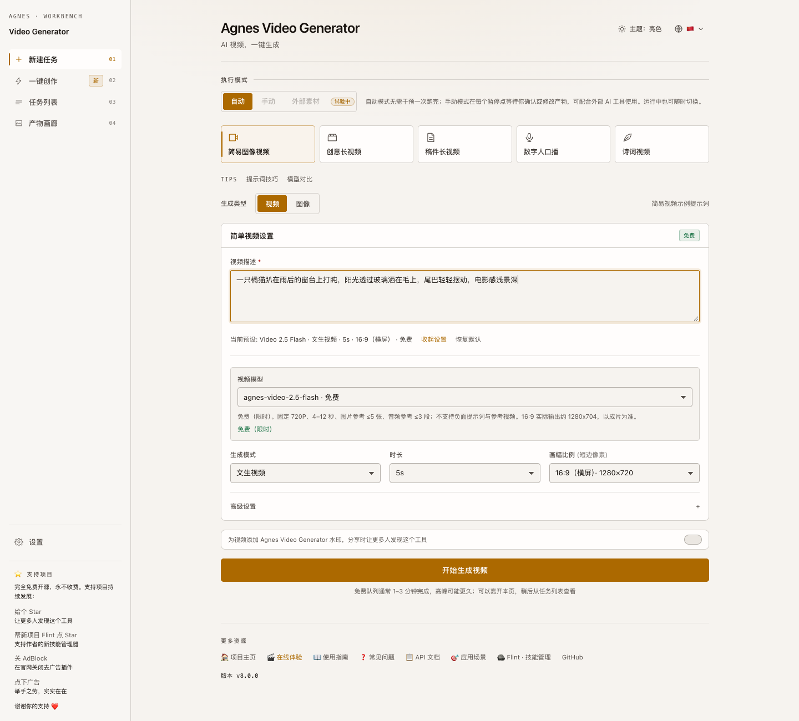

# 🎬 Agnes Video Generator — 完全免费的 AI 视频生成工具

[](/README.md)
[](https://github.com/lcy362/agnes-video-generator)
[](https://github.com/lcy362/agnes-video-generator/blob/HEAD/LICENSE)
[](https://www.python.org/)
[](https://video.lichuanyang.top)
[](https://hub.docker.com/r/lcy362/free-short-video)
[](https://www.npmjs.com/package/free-short-video)
[](https://sonarcloud.io/project/overview?id=lcy362_agnes-video-generator)
[](https://sonarcloud.io/project/overview?id=lcy362_agnes-video-generator)

<p align="center">
  
</p>

<!--
schema.org 结构化数据，供搜索引擎与 AI 引擎索引。GitHub 不会执行该脚本，但源码中的 JSON-LD 可被爬取 README 的引擎读取。
-->
<!--
<script type="application/ld+json">
{
  "@context": "https://schema.org",
  "@type": "SoftwareApplication",
  "name": "Agnes Video Generator",
  "alternateName": "免费 AI 视频生成工具",
  "applicationCategory": "MultimediaApplication",
  "operatingSystem": "Linux, macOS, Windows",
  "description": "一个完全免费、开源的 AI 视频生成工具。无需订阅、无需高端显卡、没有用量限制——输入一段文字创意，即可自动生成带旁白配音与字幕的多场景 AI 视频。支持文生视频、图生视频、关键帧动画、数字人口播与文章成片。",
  "url": "https://github.com/lcy362/agnes-video-generator",
  "downloadUrl": "https://github.com/lcy362/agnes-video-generator",
  "softwareVersion": "1.0.0",
  "license": "https://opensource.org/licenses/MIT",
  "keywords": "免费AI视频生成器, AI视频生成工具, 文字转视频AI, 免费AI视频制作, 开源视频生成器, AI旁白配音, 自动字幕, 多场景视频, Runway开源替代, Pika开源替代",
  "offers": {
    "@type": "Offer",
    "price": "0",
    "priceCurrency": "USD"
  },
  "author": {
    "@type": "Person",
    "@id": "https://lichuanyang.top/#author",
    "name": "SandGrid",
    "alternateName": "lcy362",
    "url": "https://lichuanyang.top/",
    "sameAs": [
      "https://github.com/lcy362",
      "https://gitee.com/sandgrid/agnes-video-generator",
      "https://video.lichuanyang.top/"
    ]
  }
}
</script>
-->

> **🌏 镜像说明 / Mirror Notice**
> 本项目在国内 Gitee 设有镜像仓库（[gitee.com/sandgrid/agnes-video-generator](https://gitee.com/sandgrid/agnes-video-generator)），便于国内访问加速；**GitHub 为项目主仓库**，Issue / PR / Star 均在 GitHub 提交。
> This project is also mirrored on Gitee for faster access in mainland China; the GitHub repository is the primary home for issues, PRs and stars.

> **完全免费的 AI 视频生成工具** — 基于 Agnes AI 免费模型，无需订阅、无需高端显卡、没有用量限制。输入一段文字创意，就能自动生成带旁白配音和字幕的多场景 AI 视频。支持文生视频、图生视频、关键帧动画、数字人口播等多种模式，所有 AI 计算在云端完成，普通笔记本就能跑。**[在线体验 →](https://video.lichuanyang.top)**

> "解决的办法不是压制 AI，而是让它变成一种更平权的能力，让每个人都知道如何借 AI 创造更多。这也是我们公司很重要的愿景，让世界级的 AI 属于每一个人。我们能做的可能微不足道，但这个愿景非常长久、持久。"
>
> —— Bruce Yang，Agnes AI 创始人

**[🌐 官网](https://video.lichuanyang.top)** | **[📝 博客文章（中文）](https://lichuanyang.top/posts/22470/)** | **[📝 Blog (English)](https://lichuanyang.top/en/posts/22470/)**

> **🖥️ 在线体验 — 免安装：** 打开 [video.lichuanyang.top](https://video.lichuanyang.top) 即可在浏览器中使用 **简单视频** 模式。输入提示词，立刻生成免费的 AI 视频。

## 🚀 三种使用方式 — 均完全免费

| 项目 | 运行方式 | 功能定位 | 链接 |
|------|---------|---------|------|
| **[Agnes Video Generator](https://github.com/lcy362/agnes-video-generator)**（本项目） | **下载后本地运行** | **功能更强大** —— TTS 配音、自动字幕、数字人、图生视频、关键帧动画、文章成片、断点续传等 | [GitHub](https://github.com/lcy362/agnes-video-generator) |
| **[FreeShortVideoStudio](https://github.com/lcy362/free-short-video-studio)** | **完全在线，浏览器内运行** | 轻量免安装、零配置，**功能建设中** | [video.lichuanyang.top/studio](https://video.lichuanyang.top/studio) · [GitHub](https://github.com/lcy362/free-short-video-studio) |
| **[Agnes Video Generator](https://github.com/lcy362/agnes-video-generator)** —— **支持 AI Agent 驱动** | **交给 AI 编程 Agent 运行** | **最省事** —— 装一个独立的 `agnes-video` skill：它自己装服务、出片、交付成片，失败时排查原因，还能为真正的缺陷提 PR | [技能库仓库](https://github.com/lcy362/agnes-video-generator-skills) · [Flint](https://github.com/lcy362/flint) |

## 🤖 或者，让 AI Agent 来操作

装上**一个 skill**，之后只描述想要的结果。`agnes-video` 会自己装服务、出片、交付文件并排查失败——**你不必 clone 本仓库**，这个 skill 也是独立的，不只是本项目的附属。

```bash
git clone https://github.com/lcy362/agnes-video-generator-skills.git
npx flint-skills-hub     # Sources → 添加刚 clone 的目录（flint 会读它的 skills/ 子目录）
```

[**flint**](https://github.com/lcy362/flint) 是一个本地优先的开源技能管理器：通过 symlink 或复制把这个 skill 投放到任意 Agent 目录（Claude Code、Cursor、Codex、TRAE 等），无云端、无账号、无上报。它只认本地源、**不会替你联网拉取**，所以你要登记的就是刚 clone 下来的这个目录。

**或者手动拷贝**——不用 flint 也行，代价是每个项目、每上一个新 Agent 都要再来一次：

```bash
cp -R agnes-video-generator-skills/skills/agnes-video <项目>/.agents/skills/   # 任何读 .agents/skills 的 Agent 都能用
```

**服务也由 skill 装。** 它会跑 `scripts/bootstrap.py install`，把服务装进 `~/.agnes-video`（可用 `AGNES_HOME` 覆盖），在同一处维护自己的 virtualenv，在 `localhost:8765` 启动，并且第二次使用不重复安装。配置、工作区、成片与日志都在这同一个数据根目录里。

**然后，交代结果** —— 不用命令、不用参数：

> "做一条关于旅行者号的创意长视频，要旁白和字幕。"

> "我的任务 `4de1bcd26fda` 失败了——查清原因，并告诉我值不值得修。"

> "拿我那个已完成的任务，把分镜提示词优化一下，然后只重跑受影响的部分。"

一条闭环、五个阶段，而且始终在同一个 skill 里，前后不丢上下文：

| 阶段 | 具体做什么 |
|------|------------|
| 安装 | 把服务装进 `~/.agnes-video`，并通过真实端点验证可用 |
| 创作 | 选流水线，安全接收 Key，提交任务，汇报进度 |
| 交付 | 把文件复制到 `$AGNES_HOME/outputs/<task_id>/`，报告路径、时长与分辨率 |
| 排查 | 把失败归类为配置问题、上游容量问题或真正的缺陷 |
| 修复 | 在你同意后：fork、修一个小缺陷、跑自检、提交 PR |

完整说明：**[让 AI Agent 来操作本项目](docs/public/agent-operations.zh.md)**。

## ⭐ 支持与贡献

如果你觉得这个项目有用，请给 **[GitHub 仓库](https://github.com/lcy362/agnes-video-generator)点个 Star** ⭐ —— 你的支持能让更多人发现这个免费开源的 AI 视频生成工具。

欢迎通过 [GitHub Issues](https://github.com/lcy362/agnes-video-generator/issues) 提交问题反馈或功能建议。

### 💝 支持开发者

Agnes Video Generator 完全免费且开源，**本项目绝不会提供付费计划、增值服务或订阅模式**——无论现在还是将来。

如果你觉得这个项目对你有帮助，可以通过以下方式支持它持续发展：

- **⭐ 在 GitHub 上点 Star** — 给[仓库](https://github.com/lcy362/agnes-video-generator)点个 Star，帮助更多人发现这个项目。
- **🪨 帮作者的新项目 [Flint](https://github.com/lcy362/flint) 点个 Star** —— 一个本地优先的 AI Skills（技能）管理器，配合 Claude Code / Cursor 等 Agent 使用，帮助你把经常用到的技能集中归档、打标并复用。
- **🌐 在官网关闭去广告插件** — 在 [video.lichuanyang.top](https://video.lichuanyang.top) 上关闭 AdBlock 等去广告工具，看到感兴趣的广告可以点一下。举手之劳，却是实实在在的支持。
- **📢 分享你的创作** — 将你用 Agnes Video Generator 生成的视频发布到社交媒体（抖音、YouTube、小红书等）并标注本项目。让更多人知道这个工具，更多的用户意味着更多的反馈，项目也会变得更好。

## 🎥 Demo

以下 3 条来自[官网作品库](https://video.lichuanyang.top/zh/showcase)最新一批（2026-11-09 发布），都是在简单视频模式下一句提示词直出，没有剪辑与合成。

### 1. 冷调走廊｜极近怼脸后拉

> 起幅是极近怼脸，镜头实拍后拉到半身，冷灰走廊配钴蓝高领毛衣，毛孔与碎发细节都保留。12 秒横版，720P。

[](https://video.lichuanyang.top/zh/showcase/ab-01-cold-corridor-face-closeup)

### 2. 盛唐夜樱｜古装高髻人像

> 盛唐高髻与发簪立于夜樱之下，花瓣掠过、灯笼暖光落在脸颊，镜头缓慢横移。6 秒竖版，720P。

[](https://video.lichuanyang.top/zh/showcase/ab-03-tang-dynasty-night-sakura)

### 3. 红色片场｜香水广告

> 红色片场里的香水广告：喷雾炸开，侧脸与红唇近景，缓慢推进，灯光干净利落。10 秒横版，720P。

[](https://video.lichuanyang.top/zh/showcase/ab-12-red-studio-perfume-ad)

<sub>更多作品：[video.lichuanyang.top/showcase](https://video.lichuanyang.top/zh/showcase)</sub>

## 为什么选择 Agnes Video Generator？

现在做 AI 视频，门槛高得离谱。国外的 Runway、Pika 按月订阅动辄几十美元，国内的即梦、可灵免费额度一用完就按秒计费。想自己在本地跑开源模型？一张能跑视频生成的显卡轻松上万。对于大多数想尝试 AI 视频创作的人来说，这道门基本上是关着的。

我们相信 Bruce Yang 说的那句话——AI 应该是一种更平权的能力。世界级的 AI 应该属于每一个人，而不是只属于付得起账单的人。

坦白讲，Agnes 的视频模型现在还不够完美。生成的画面有时不够稳定，复杂动作偶尔会变形。但它**完全免费、没有用量限制**，而且迭代速度很快。我们选择跟它一起成长，而不是等着一个「完美」的商业方案出现。如果你也认同这个想法，那么这个项目就是为你准备的——你只需要一个免费的 [Agnes AI](https://platform.agnes-ai.com) API Key 和一台能跑 Python 的普通电脑，就可以零成本开始 AI 视频创作。

### 对比：Agnes 与商业 AI 视频工具

| 特性 | Agnes Video Generator | Runway Gen-3 | Pika 2.0 | OpenAI Sora | 可灵 Kling 1.6 |
|------|:---:|:---:|:---:|:---:|:---:|
| **价格** | 完全免费 | $15–$95/月 | $10–$95/月 | $20+/月（限量） | 免费额度后按秒计费 |
| **开源** | ✅ 是（MIT） | ❌ 否 | ❌ 否 | ❌ 否 | ❌ 否 |
| **自托管** | ✅ 支持 | ❌ 不支持 | ❌ 不支持 | ❌ 不支持 | ❌ 不支持 |
| **单段最长时长** | 20秒，场景数不限 | 10秒 | 10秒 | 20秒 | 10秒 |
| **多场景流水线** | ✅ 内置（创意/稿件模式） | ❌ 需手动编辑 | ❌ 需手动编辑 | ❌ 需手动编辑 | ❌ 需手动编辑 |
| **AI 旁白配音** | ✅ 免费内置 | ❌ 需第三方 | ❌ 需第三方 | ❌ 不支持 | ❌ 不支持 |
| **自动字幕** | ✅ 词级 SRT | ❌ 不支持 | ❌ 不支持 | ❌ 不支持 | ❌ 不支持 |
| **数字人口播** | ✅ 内置 | ❌ 无 | ❌ 无 | ❌ 无 | ❌ 无 |
| **分辨率选项** | 9:16 / 16:9 / 1:1 | 多种 | 多种 | 多种 | 多种 |
| **图生视频** | ✅ 支持 | ✅ 支持 | ✅ 支持 | ✅ 支持 | ✅ 支持 |
| **关键帧动画** | ✅ 支持 | ✅ 支持 | ✅ 支持 | ❌ 不支持 | ❌ 不支持 |
| **本地 GPU 需求** | ❌ 不需要（云端 API） | ❌ 不需要（云端） | ❌ 不需要（云端） | ❌ 不需要（云端） | ❌ 不需要（云端） |
| **水印** | 无水印 | 内置水印 | 内置水印 | C2PA 元数据 | 内置水印 |
| **使用限制** | 无限（16次/分钟限速） | 按计算量计费 | 按生成量计费 | 按生成量计费 | 按生成量计费 |

## ⚙️ 配置说明

所有配置均通过环境变量设置，无需配置文件。如需一份带注释的模板，可直接复制项目自带的 `.env.example`：

```bash
cp .env.example .env    # 然后编辑其中的 AGNES_API_KEY
```

[`.env.example`](.env.example) 列出了全部支持的环境变量及其默认值：API Key、多 Key 轮询、限速参数、服务端口、模型覆盖与运维选项。

> **有多个 API Key？** 依次设置 `AGNES_API_KEY`、`AGNES_API_KEY_2`、`AGNES_API_KEY_3` …（序号必须连续）。限速配额会随 Key 数量线性放大，遇到 429 会自动轮换到下一个 Key，并发上限也随之提升。

完整步骤见：[快速开始 → 配置 API Key](docs/public/getting-started.zh.md)。

## 📚 文档导航

- **[核心功能](docs/public/features.zh.md)** — 多种创作模式、完全免费的 AI 模型链、AI 旁白配音与智能字幕、灵活的创作控制、生产级可靠性与多语言 Web UI。
- **[快速开始](docs/public/getting-started.zh.md)** — 4 种部署方式：手动（`start.sh`）、Docker、npm（`npx free-short-video`）、AI Agent 辅助。
- **[AI Agent 操作指南](docs/public/agent-operations.zh.md)** — 用编程 Agent 驱动本项目：装一次独立的 `agnes-video` skill，之后交代结果即可——它自己装服务、出片、排查失败，还能为真正的缺陷提 PR。
- **[使用说明](docs/public/usage.zh.md)** — 配置 API Key、选择视频模式、断点续传、三种串联模式，以及日志与输出目录。
- **[项目架构](docs/public/architecture.zh.md)** — 项目结构与技术栈。
- **[API 接口](docs/public/api.zh.md)** — 完整 REST 接口列表（进度经任务状态轮询获取，无 WebSocket）。
- **[常见问题](docs/public/faq.zh.md)** — 高频疑问解答。
- **[关于与许可](docs/public/about.zh.md)** — 致谢与 MIT 开源协议。

## 🌐 相关项目

作者的其他开源项目：

- **[Agnes Video Generator](https://github.com/lcy362/agnes-video-generator)** —— 完全免费的 AI 视频生成器（本项目）。
- **[FreeShortVideoStudio](https://github.com/lcy362/free-short-video-studio)** —— 完全在线、浏览器内运行的视频工作台。
- **[Flint](https://github.com/lcy362/flint)** —— 本地优先的 AI Skills（技能）管理器：集中归档、打标、去重，并通过 symlink/复制部署到任意 Agent 或项目目录。如果对你有帮助，欢迎点个 Star！⭐

**关键词**：免费AI视频生成器, AI视频生成工具, 文字转视频AI, 免费AI视频制作, AI视频创作, 开源视频生成器, Agnes AI, 文生视频, 图生视频, 关键帧视频, AI旁白配音, 自动字幕, 多场景视频, 零成本AI视频, 无需订阅的AI视频工具, 数字人口播, 自托管AI视频生成器, Runway开源替代
